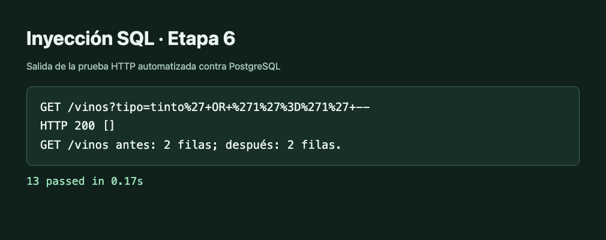

# Etapa 6 · API REST

La API conecta por TCP con PostgreSQL mediante psycopg y un pool de 1 a 8 conexiones. FastAPI publica las rutas y genera Swagger a partir de los modelos de entrada y salida. Docker Compose levanta la base y la API. La [guía de arranque](../../api/README.md) incluye los pasos para una base nueva y para un volumen que ya tiene los datos de las etapas anteriores.

## Recorrido por el código

| Archivo | Qué mirar |
| --- | --- |
| [app/modelos.py](../../api/app/modelos.py) | Contratos HTTP, subtipos de cliente e importes decimales serializados como cadenas JSON. |
| [app/db.py](../../api/app/db.py) | Configuración por entorno, apertura y cierre del pool, y devolución de conexiones. |
| [app/main.py](../../api/app/main.py) | Rutas, transacciones, códigos HTTP y traducción central de errores. |
| [app/consultas.py](../../api/app/consultas.py) | Sentencias SQL con parámetros separados, una función por consulta. |
| [009_compatibilidad_api.sql](../../db/migrations/009_compatibilidad_api.sql) | Auditoría con rol limitado y control de composición en bajas de vinos. |
| [tests/test_api.py](../../api/tests/test_api.py) | Peticiones HTTP y comprobaciones contra la base real. |

## Rutas y convenciones

| Recurso | Rutas |
| --- | --- |
| Salud | `GET /salud` |
| Vinos | `GET /vinos`, `GET /vinos/{codigo}`, `POST /vinos`, `PUT /vinos/{codigo}`, `DELETE /vinos/{codigo}` |
| Clientes | `GET /clientes`, `GET /clientes/{codigo}`, `POST /clientes`, `PUT /clientes/{codigo}`, `DELETE /clientes/{codigo}` |
| Comprobantes | `POST /comprobantes`, `GET /comprobantes/{numero}` |
| Transferencias | `POST /transferencias` y `POST /transferencias/{numero}/renglones`, `/terminar`, `/procesar` |
| Ingresos | `POST /ingresos` y `POST /ingresos/{codigo}/renglones`, `/terminar`, `/procesar` |
| Reportes | `GET /reportes/top-vinos`, `/ventas-por-sala`, `/vinos-sin-stock`, `/transportista-activo`, `/trazabilidad/{codigo}` |

- Los listados reciben `limite` entre 1 y 100 y `offset` desde 0. Ejemplo con el catálogo `GET /vinos?tipo=tinto&cepa=1&bodega=20111111111&anada=2024&limite=10&offset=0`.
- Los IDs de vino, venta, ingreso y transferencia se envían en el alta, de acuerdo con el esquema existente. PostgreSQL genera el ID del cliente.
- `PUT /vinos/{codigo}` reemplaza la ficha, la composición y los maridajes. Una venta, un saldo o un registro de auditoría pueden impedir la baja por sus claves foráneas.
- El cliente incluye `tipo` con uno de tres valores. El distribuidor requiere `zona_cobertura` y `numero_habilitacion`, y el exportador, `pais_destino_principal`. Si hay permisos asociados al exportador, la clave foránea protege la baja o el cambio a otro subtipo.
- El circuito de ingresos y transferencias es alta, renglones, terminar y procesar. El trigger de renglones bloquea la cabecera para que la edición y el cierre se resuelvan en orden. Al pasar a procesado, el trigger de estado aplica el movimiento de stock.
- Los reportes corresponden a S1, S8, S6, S7 y S9. Para S6 se indica `?sala=1`. La trazabilidad S9 muestra bodega, composición, maridajes y stock según las relaciones que ya existen.

## Cómo se confirma una venta

`POST /comprobantes` abre una transacción con `db.transaction()`. Psycopg envía `BEGIN` y confirma con `COMMIT` al salir normalmente. Si una sentencia o una restricción diferida falla, ejecuta `ROLLBACK` y el manejador traduce el SQLSTATE.

La API inserta la cabecera con los importes en cero por defecto y toma los precios de `vino`. Los triggers validan y bloquean el stock, aplican el descuento, actualizan el saldo y recalculan los totales. Una de las pruebas consigue insertar el primer renglón y falla por stock en el segundo. Comprueba que el comprobante desaparece y que se restaura el stock del primer vino.

El alta y la edición de un vino agrupan la ficha y la composición en una transacción para que PostgreSQL verifique el 100 % al confirmar. Los cambios de clientes usan la función de descuento existente luego de guardar su subtipo. Para procesar ingresos y transferencias, la API ejecuta `CALL` sobre los procedimientos de la etapa 2.

## Permisos y errores

La conexión usa `bodega_api`. Con la migración 011, ese rol lee los saldos y los importes calculados. Los triggers actualizan los importes y el stock. El trigger de auditoría escribe como su propietario y registra `SESSION_USER`, que identifica al rol que abrió la conexión. La prueba de precios verifica que `bodega_api` carece de permiso de inserción directa en auditoría.

| SQLSTATE | HTTP | Caso |
| --- | --- | --- |
| `23505` | 409 | Duplicado. |
| `23503` | 409 | Clave foránea. |
| `23514`, `23502` | 422 | CHECK o NOT NULL. |
| `P0001` | 409 | Regla rechazada por trigger o procedimiento. Se devuelve su mensaje. |
| `22P02` | 400 | Valor con formato inválido en PostgreSQL. |
| `40001`, `40P01` | 503 | Conflicto transitorio. Incluye `Retry-After`. |
| `22001`, `22003` | 422 | Longitud o rango inválido. |

FastAPI devuelve 422 si el cuerpo o los parámetros ya incumplen el contrato HTTP. Los errores de integridad de PostgreSQL incluyen `sqlstate` y, cuando corresponde, `restriccion`.

## Prueba de inyección SQL

Con una base cargada, comparar estas llamadas:

```sh
curl -sS 'http://localhost:8000/vinos'
curl -sS -i --get 'http://localhost:8000/vinos' --data-urlencode "tipo=tinto' OR '1'='1' --"
curl -sS 'http://localhost:8000/vinos'
```

El valor entra como parámetro `tipo` de psycopg y la comparación busca ese texto literal. En la prueba automatizada había dos vinos antes y después. La petición con la cadena maliciosa devolvió HTTP 200 con `[]`.



## Verificación

`bash api/tests/probar.sh` ejecuta 13 pruebas contra PostgreSQL. Cubre el catálogo, la inyección, los tres subtipos, la auditoría, la venta, los movimientos de stock y los cinco reportes. Las pruebas de error incluyen precio negativo, composición incompleta, documento duplicado, venta sin stock y procesamiento en estado incorrecto. También se ejecutó [la suite SQL anterior](../../db/tests/db_tests.sql) sobre una base recién migrada y completó hasta el `ROLLBACK` final.

También se comprobó la actualización de un volumen de la etapa 5. Los vinos cargados antes de aplicar 009 y configurar el rol siguieron disponibles por la API.
